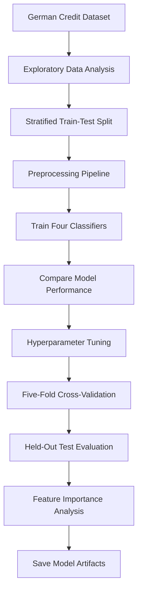

# Credit Scoring Model — Credit Risk Prediction


A machine learning project developed as part of my **CodeAlpha internship**, focused on classifying applicants into **Good Risk** and **Bad Risk** categories using the German Credit Dataset. Four classification algorithms were evaluated, and a tuned XGBoost pipeline was selected as the best-performing model in my experiments.

> **Note:** This project predicts credit-risk categories. It does not calculate an official numerical credit score, such as a CIBIL or FICO score.

## Table of Contents

1. [CodeAlpha Internship Context](#codealpha-internship-context)
2. [Problem Statement and Objectives](#problem-statement-and-objectives)
3. [Dataset](#dataset)
4. [Tech Stack](#tech-stack)
5. [Workflow](#workflow)
6. [Project Structure](#project-structure)
7. [Preprocessing](#preprocessing)
8. [Models and Results](#models-and-results)
9. [Hyperparameter Tuning and Cross-Validation](#hyperparameter-tuning-and-cross-validation)
10. [Evaluation and Confusion Matrix](#evaluation-and-confusion-matrix)
11. [Feature Importance](#feature-importance)
12. [Saved Model Artifacts](#saved-model-artifacts)
13. [Installation](#installation)
14. [Using the Saved Pipeline](#using-the-saved-pipeline)
15. [Limitations and Responsible Use](#limitations-and-responsible-use)
16. [Key Learning Outcomes](#key-learning-outcomes)
17. [Author](#author)
18. [Acknowledgment](#acknowledgment)

## CodeAlpha Internship Context

This project was assigned by **CodeAlpha** as part of my Machine Learning Internship and completed by me, **Karanam Shasank**.

The task involved developing and evaluating a machine learning model to classify credit applicants into risk categories using historical applicant data.

## Problem Statement and Objectives

Credit risk assessment helps lenders estimate the potential risk associated with lending to applicants. This project approaches the problem as binary classification: given an applicant's financial and personal attributes, predict whether the applicant belongs to the Good Risk or Bad Risk category.

**Objectives**

- Build a reproducible preprocessing and modelling workflow using scikit-learn pipelines.
- Compare Logistic Regression, Decision Tree, Random Forest, and XGBoost.
- Tune XGBoost using cross-validation.
- Evaluate performance using precision, recall, F1-score, ROC-AUC, and confusion matrices.
- Analyse feature importance.
- Save the final preprocessing and classification pipeline for reuse.

## Dataset

**Dataset:** German Credit Dataset

| Characteristic | Value |
|---|---:|
| Total records | 1,000 |
| Input features | 20 |
| Good Risk records | 700 |
| Bad Risk records | 300 |

### Target mapping

| Original label | Meaning |
|---|---|
| `1` | Good Risk |
| `2` | Bad Risk |

The dataset includes attributes such as credit amount, loan duration, credit history, checking account status, savings, employment, housing, and age.

The target distribution is 70% Good Risk and 30% Bad Risk. For precision, recall, and F1-score, **Bad Risk is treated as the positive class**.

## Tech Stack

| Area | Tools |
|---|---|
| Programming language | Python |
| Data handling | Pandas, NumPy |
| Machine learning | Scikit-learn |
| Gradient boosting | XGBoost |
| Model persistence | Joblib |
| Visualisation | Matplotlib, Seaborn, where used |
| Development environment | Jupyter Notebook, Google Colab |
| Version control | Git, GitHub |

## Workflow



## Project Structure

```text
CodeAlpha_Credit_Scoring/
├── credit_scoring_artifacts/
│   ├── credit_scoring_pipeline.joblib
│   ├── model_metadata.json
│   └── feature_importance.csv
├── notebooks/
│   ├── [EDA notebook]
│   ├── [Preprocessing notebook]
│   ├── [Model training notebook]
│   └── 04_Credit_Scoring_Model_Evaluation.ipynb
└── README.md
```

The evaluation notebook and saved artifacts have been added to the repository. Replace the three bracketed notebook descriptions with the actual filenames if you want the project tree to list every notebook explicitly.

## Preprocessing

Preprocessing was implemented using a scikit-learn `ColumnTransformer` and pipelines to ensure consistent transformations during model training and prediction.

| Feature type | Preprocessing |
|---|---|
| Numerical | Median imputation followed by `StandardScaler` |
| Categorical | Most-frequent imputation followed by `OneHotEncoder` |

The dataset was split into training and testing sets using stratification, preserving the target-class proportions.

The preprocessing steps were fitted as part of each model pipeline to prevent information from the test set leaking into training.

## Models and Results

Four classification algorithms were trained and evaluated:

1. Logistic Regression
2. Decision Tree
3. Random Forest
4. XGBoost, followed by hyperparameter tuning

### Tuned XGBoost — held-out test results

| Metric | Score |
|---|---:|
| Accuracy | 78.50% |
| Precision | 67.35% |
| Recall | 55.00% |
| F1-score | 0.6055 |
| ROC-AUC | 0.8031 |

The results above use **Bad Risk as the positive class**.

Tuned XGBoost was the best-performing model in my experiments based on the metrics evaluated. This does not mean it will outperform every other algorithm on different datasets.

*The complete model comparison table can be added after confirming the final evaluation outputs for all four models.*

## Hyperparameter Tuning and Cross-Validation

XGBoost was tuned using `RandomizedSearchCV` with stratified five-fold cross-validation. The F1-score was used as the tuning objective, with Bad Risk treated as the positive class.

### Best hyperparameters

| Parameter | Value |
|---|---:|
| `n_estimators` | 300 |
| `max_depth` | 3 |
| `learning_rate` | 0.1 |
| `subsample` | 0.8 |
| `colsample_bytree` | 1.0 |

### Five-fold cross-validation results

| Metric | Value |
|---|---:|
| Mean F1-score | 0.5487 |
| F1-score standard deviation | 0.0416 |
| Mean recall | 0.5042 |
| Mean ROC-AUC | 0.7911 |

Cross-validation measures performance across multiple training folds, while the held-out test set provides a separate evaluation. These results offer complementary evidence about model performance; they do not establish that the model will generalise reliably to every new dataset.

## Evaluation and Confusion Matrix

The tuned XGBoost model achieved the following confusion matrix on the 200-record held-out test set.

| Actual class | Predicted Good Risk | Predicted Bad Risk |
|---|---:|---:|
| Good Risk | 124 | 16 |
| Bad Risk | 27 | 33 |

### Interpretation

- **Accuracy:** 78.5% of the test examples were classified correctly.
- **Precision:** Of applicants predicted as Bad Risk, approximately 67.35% were actually Bad Risk.
- **Recall:** The model identified 33 of the 60 actual Bad Risk applicants, corresponding to 55% recall.
- **Missed Bad Risk cases:** The model classified 27 actual Bad Risk applicants as Good Risk.
- **ROC-AUC:** A score of 0.8031 indicates useful class-separation ability in this test setting.

Accuracy alone is insufficient for this dataset because predicting Good Risk for every applicant would already achieve 70% accuracy. Recall and other class-sensitive metrics therefore provide important additional context.

## Feature Importance

Feature importance values from the trained XGBoost classifier are saved in:

`credit_scoring_artifacts/feature_importance.csv`

This file can be used to inspect which encoded features contributed most to the model's predictions.

Feature importance reflects model-specific predictive usefulness. It does not establish causation, prove fairness, or indicate an individual applicant's probability of default.

## Saved Model Artifacts

| File | Description |
|---|---|
| `credit_scoring_pipeline.joblib` | Saved preprocessing and tuned XGBoost pipeline |
| `model_metadata.json` | Model details, selected hyperparameters, and evaluation metrics |
| `feature_importance.csv` | Feature-importance values from the trained classifier |

The saved pipeline was successfully loaded and tested locally using a synthetic example record. The model predicted Good Risk and returned an estimated Bad Risk probability of 12.40%.

This was a demonstration of model inference, not a real applicant assessment.

## Installation

The saved pipeline depends on compatible versions of scikit-learn and XGBoost. Use the dependency versions verified for the saved artifact.

Clone the repository:

```bash
git clone https://github.com/Someone18-6/CodeAlpha_Credit_Scoring.git
cd CodeAlpha_Credit_Scoring
```

Create and activate a virtual environment on Windows:

```powershell
python -m venv .venv
.\.venv\Scripts\Activate.ps1
```

Install dependencies from a verified `requirements.txt` file if one is available:

```bash
python -m pip install -r requirements.txt
```

**Compatibility note:** The saved pipeline loaded successfully locally with Python 3.10 and scikit-learn 1.6.1. The training environment reported XGBoost 3.4.1, which could not be installed in the local Python 3.10 environment. Verify and pin the local XGBoost version that successfully loads the artifact before documenting a fully reproducible installation.

## Using the Saved Pipeline

The saved pipeline can be loaded with Joblib. The input must contain the 20 expected feature columns with the same names and compatible raw input formats used during training.

```python
import joblib

model = joblib.load(
    "credit_scoring_artifacts/credit_scoring_pipeline.joblib"
)

# Supply a DataFrame containing all 20 expected input features.
# Use values formatted consistently with the training dataset.
# prediction = model.predict(applicant_data)
# probabilities = model.predict_proba(applicant_data)
```

The fitted pipeline applies its saved preprocessing steps before generating predictions. The positive-class probability must be interpreted using the class ordering established by the trained model.

The model output is an experimental risk prediction, not an official credit score or a stand-alone lending decision.

## Limitations and Responsible Use

- **Dataset size:** The dataset contains 1,000 records, which limits the conclusions that can be drawn about generalisation.
- **Moderate recall:** The model missed 27 of the 60 Bad Risk cases in the held-out test set.
- **Dataset relevance:** Historical German credit data may not represent current applicants or other markets.
- **Fairness:** A dedicated bias and fairness audit has not been established by the results documented here.
- **Probability calibration:** The reported probability has not been established as a calibrated real-world default probability.
- **Deployment:** This is an educational internship project, not a production lending system.

Further external validation, fairness testing, probability calibration, and monitoring would be necessary before considering any real-world use. Model predictions should never be the sole basis for consequential lending decisions.

## Key Learning Outcomes

- Building preprocessing and classification pipelines using scikit-learn.
- Handling numerical and categorical features.
- Comparing classification algorithms using multiple evaluation metrics.
- Performing hyperparameter tuning and stratified cross-validation.
- Interpreting confusion matrices, recall, precision, F1-score, and ROC-AUC.
- Analysing feature importance.
- Saving and reloading trained machine learning pipelines.
- Understanding dependency compatibility and reproducibility.

## Author

**Karanam Shasank**

- GitHub: [Someone18-6](https://github.com/Someone18-6)
- Project repository: [CodeAlpha_Credit_Scoring](https://github.com/Someone18-6/CodeAlpha_Credit_Scoring)
- LinkedIn: [Karanam Shasank](https://www.linkedin.com/in/karanam-shasank-3a4355329/)

## Acknowledgment

I would like to thank **CodeAlpha** for assigning this project as part of my Machine Learning Internship and providing an opportunity to apply machine learning techniques to a credit-risk classification problem.
